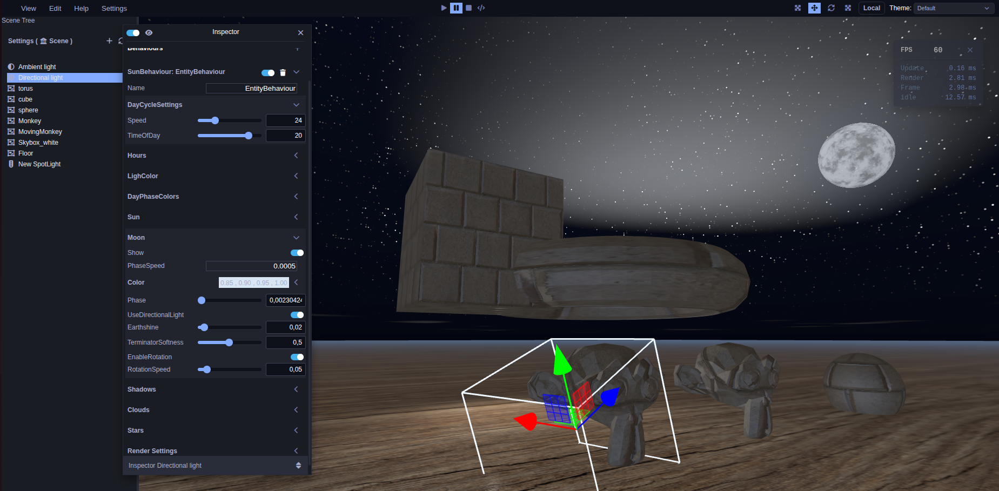

# Omega Editor

<p align="center">
  <a href="readme-assets/image.png" target="_blank">
    
  </a>
  <a href="readme-assets/image1.png" target="_blank">
    
  </a>
</p>

**Omega Editor** is a web-based 2D/3D game engine and editor built with Angular and WebGL.

This is an ongoing personal project rather than a commercial product. I built it as a practical sandbox to apply and consolidate years of learning in Angular architecture, game systems design, and low-level engine development. While it is very much a work in progress, it already features a robust rendering pipeline supporting custom shaders, complex materials, dynamic lighting, and shadows. Beyond rendering, the editor provides deep visibility into the engine's state, allowing for live inspection of entities, components, and underlying engine code directly through the UI.

## 🌌 The Omega Ecosystem

The editor is one of four pieces. To use it locally you need **three processes running**: the editor, the API and the code service.

| Piece | Repository | Stack | Default port | Role |
| :--- | :--- | :--- | :--- | :--- |
| **Omega Editor** (this repo) | [`tugapse/omega-editor`](https://github.com/tugapse/omega-editor) | Angular 20 | `4200` | UI, inspectors, scene management, Monaco code editor |
| **Omega API** | [`tugapse/omega-api-cs`](https://github.com/tugapse/omega-api-cs) | ASP.NET Core 8, EF Core (SQLite/PostgreSQL), JWT | `5000` | Gateway: auth, users, projects, assets; proxies code requests to the code service |
| **Omega Code Service** | [`tugapse/omega-code-service`](https://github.com/tugapse/omega-code-service) | Node.js, Express 5, esbuild, TypeScript API | `3000` | User script workspaces: file I/O, compile to `bundle.js`, emit `.d.ts` typings |
| **Omega Engine** | npm [`omega-game-engine`](https://www.npmjs.com/package/omega-game-engine) | TypeScript, WebGL | – | Rendering and ECS core; a dependency of both the editor and the code service |

> The older Python [`omega-api`](https://github.com/tugapse/omega-api) backend has been replaced by `omega-api-cs`. The `npm run run-dev` script in this repo still points at it and no longer applies.

### How the pieces talk

```
Browser ──► Omega Editor (:4200)
               │  HTTP + JWT (Authorization: Bearer …)
               ▼
            Omega API (:5000)  ── SQLite  Data/database.db
               │  /api/projects/{id}/code/*  →  forwarded with the user's id
               ▼
            Omega Code Service (:3000)
               │
               ▼
     shared storage root:  {OMEGA_PROJECTS_STORAGE_ROOT}/{userId}/projects/{projectId}/
                              ├── src/    user TypeScript (main.ts, behaviours…)
                              └── dist/   bundle.js, main.d.ts
```

* The editor **only ever talks to the API**. It never calls the code service directly.
* The API writes project and asset folders to the storage root. The code service reads and writes the same folders for scripts and builds. **Both services must use the same storage root**: see [Shared storage](#3-shared-storage-required).

## ✨ Key Features

* **Entity-Component-System (ECS) and live inspection:** granular control over entities through a modular behaviour system. The editor lets you inspect and change entities, their components and raw engine code in real time.
* **Advanced WebGL rendering:** custom shaders, complex material properties, dynamic lighting (ambient, directional, spot) and real-time shadow mapping.
* **Custom user logic and scripting:** user TypeScript is edited in Monaco, compiled server-side by the code service and run live in the engine. The day/night cycle in the screenshots (with configurable moon phases and shadow transitions) is one example of a custom behaviour.
* **Editor tooling:**
  * Interactive 3D transform gizmos (translate, rotate, scale).
  * Real-time performance profiling (FPS, Update, Render and Idle ms).
  * Integrated asset and project management.
  * UI theming (e.g. "Autumn Rust" and "Default").

---

## 🚀 Getting Started

> **⚠️ WIP:** there is no unified start script yet. Start the three services by hand, in the order below.

### Prerequisites

| Tool | Version | Needed by |
| :--- | :--- | :--- |
| Node.js + npm | 18+ (developed on 26) | editor, code service |
| .NET SDK | 8.0+, with the **ASP.NET Core 8 runtime** (the project targets `net8.0`) | API |
| Angular CLI | 20 (optional: `npx ng` works too) | editor |

### 1. Clone the three repositories side by side

```bash
mkdir omega && cd omega
git clone https://github.com/tugapse/omega-api-cs.git
git clone https://github.com/tugapse/omega-code-service.git
git clone https://github.com/tugapse/omega-editor.git
```

### 2. Install dependencies

```bash
(cd omega-code-service && npm install)
(cd omega-editor && npm install)          # also pulls omega-game-engine
(cd omega-api-cs && dotnet restore)
```

### 3. Shared storage (required)

The API and the code service each have their **own default** storage folder, and the defaults do not match:

| Service | Default when `OMEGA_PROJECTS_STORAGE_ROOT` is unset |
| :--- | :--- |
| omega-api-cs | `omega-api-cs/storage` |
| omega-code-service | `omega-code-service/storage/projects` |

If you leave the defaults, scripts created in the editor land in a different folder from the project the API created. Export **one** absolute path in every shell that starts a service:

```bash
export OMEGA_PROJECTS_STORAGE_ROOT="$HOME/omega-storage"
```

The API also expands a leading `~` or `$HOME` in this value. The code service does not, so use an absolute path.

### 4. Start the services (one terminal each)

```bash
# Terminal 1: code service on :3000
cd omega-code-service
export OMEGA_PROJECTS_STORAGE_ROOT="$HOME/omega-storage"
./run.sh                    # = npm run start (ts-node src/index.ts)

# Terminal 2: API on :5000
cd omega-api-cs
export OMEGA_PROJECTS_STORAGE_ROOT="$HOME/omega-storage"
./run.sh                    # = dotnet run (profile "http", Development)

# Terminal 3: editor on :4200
cd omega-editor
npm start                   # = ng serve
```

Open `http://localhost:4200/`, register a user, log in and create a project. The editor reloads on source changes.

### 5. Check that everything is up

```bash
curl http://localhost:5000/api/health                      # API
curl -I http://localhost:3000/api/compiler/engine-typings  # code service
```

In Development mode, the API also serves Swagger UI at `http://localhost:5000/swagger`.

---

## ⚙️ Configuration reference

### Omega Editor

| Where | Setting | Default |
| :--- | :--- | :--- |
| `src/environment.ts` | `apiUrl`: API base URL (the app appends `/api`) | `http://localhost:5000` |
| `src/editor/configs/editor.ts` | `APISettings.apiHost`: legacy setting, also hard-coded | `http://localhost:5000/api/` |

### Omega API (`omega-api-cs`)

| Where | Setting | Default |
| :--- | :--- | :--- |
| `Properties/launchSettings.json` | Listen URL (profile `http`) | `http://localhost:5000` |
| `appsettings.json` → `DatabaseProvider` | `SQLite` or `PostgreSQL` | `SQLite` |
| `appsettings.json` → `ConnectionStrings` | SQLite file / PostgreSQL connection | `Data/database.db` (created on first run) |
| `appsettings.json` → `JwtSettings` | `SecretKey`, `Issuer`, `Audience`, `ExpirationMinutes` | dev key, 7 days. **Change `SecretKey` outside local dev.** |
| env `OMEGA_PROJECTS_STORAGE_ROOT` | Storage root | `./storage` |
| `Services/AssetCodeService.cs`, `Services/Omega*Service.cs`, `Controllers/AssetCodeController.cs` | Code service URL (**hard-coded**) | `http://localhost:3000/api` |

### Omega Code Service

| Env variable | Description | Default |
| :--- | :--- | :--- |
| `PORT` | Listen port. If you change it, the hard-coded URL in the API must change too. | `3000` |
| `OMEGA_PROJECTS_STORAGE_ROOT` | Storage root (must match the API) | `./storage/projects` |
| `OMEGA_ENGINE_TYPINGS_PATH` | Engine `.d.ts` served to Monaco | `node_modules/omega-game-engine/dist/omega-game-engine.d.ts` |

---

## 🛰️ API surface used by the editor

All routes are on the API (`:5000`). All except auth and health need `Authorization: Bearer <jwt>`.

| Area | Routes |
| :--- | :--- |
| Auth | `POST /api/auth/register`, `POST /api/auth/login`, `POST /api/auth/logout` |
| Health | `GET /api/health` |
| User | `GET`/`PATCH /api/users/me`, `GET`/`PUT /api/users/me/preferences` |
| Projects | `GET`/`POST /api/projects`, `GET`/`PATCH`/`DELETE /api/projects/{id}` |
| Assets | `GET`/`POST /api/projects/{id}/assets`, `GET`/`PATCH`/`DELETE …/assets/{assetId}`, `GET`/`PUT …/assets/{assetId}/text` |
| Code (proxied to the code service) | `GET …/code/tree`, `GET`/`POST`/`PUT`/`DELETE …/code/files`, `GET …/code/engine-typings`, `GET …/code/workspace-typings`, `POST …/code/compile`, `GET …/code/bundle` |

---

## ⚠️ Known issues

* **Engine typings path:** `omega-game-engine@3.0.3` ships `dist/index.d.ts`, not the single-file `dist/omega-game-engine.d.ts` the code service expects. Until a bundled `.d.ts` is published, `GET …/code/engine-typings` fails and compilation has no engine types. `compiler.ts` hard-codes this path, so setting `OMEGA_ENGINE_TYPINGS_PATH` only fixes the typings endpoint, not the compiler.
* **Hard-coded URLs:** the API's code-service URL and the editor's `APISettings.apiHost` are constants, not configuration.
* **`npm run run-dev`** still starts the old Python `omega-api`.

---

## 🛠 Development commands (editor)

| Command | What it does |
| :--- | :--- |
| `npm start` | Dev server on `:4200` |
| `npm run build` | Production build into `dist/` |
| `npm run watch` | Development build in watch mode |
| `npm test` | Unit tests (Karma + Jasmine) |
| `npm run build-shaders` | Regenerates shader sources (`generate-shaders.js`) |
| `npm run build-docs` | TypeDoc API docs into `docs/` |

`AgentDocs/` holds per-file architecture notes, written for AI agents and newcomers.

This project was generated with [Angular CLI](https://github.com/angular/angular-cli) 20.1.3. Run `ng generate component <name>` to scaffold (also `directive`, `pipe`, `service`, `class`, `guard`, `interface`, `enum`, `module`). See the [Angular CLI reference](https://angular.dev/tools/cli).
